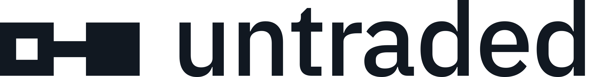

<h1>
  <picture>
    <source media="(prefers-color-scheme: dark)" srcset="docs/brand/untraded-horizontal-long-paper.svg">
    
  </picture>
</h1>

**Never die untraded.**

Untraded is an open-source, self-hostable Counter-Strike 2 analyzer and coach. It fetches your matches, parses the demos, and tells you — after every session — the one to three things to fix, with the rounds that prove it. Every metric has a public formula, and your data stays yours.

> **Status: alpha, phase 2 (solo beta) under way.** The [`untraded`](packages/untraded-py) metrics engine and command line (`pip install untraded`) are validated against CS Demo Manager on 30 matches. On top of it, a self-hostable stack collects Premier matches from Valve, takes FACEIT, ESEA and scrim demos sent from the site, and shows each player their sessions, matches, priorities and a 2D round viewer. Team features come in phase 3. See the [roadmap](docs/roadmap.md).

## Why

- **Explainable.** Every number has a documented, versioned formula ([docs/metrics](docs/metrics/README.md)). An open win-probability model ([docs/winprob.md](docs/winprob.md)) shows how much each kill, death, plant and defuse moved the round.
- **Actionable.** At most three priorities per session report, from open rules ([docs/advice.md](docs/advice.md)), each with evidence rounds, a drill or in-game adjustment, and an indicator followed into the next sessions.
- **Built for high-level play.** Premier, FACEIT, ESEA and scrims. Team review and tactical stats are planned (phase 3).
- **Yours.** Self-host it with Docker Compose and query it with SQL. Players can erase their data from the settings.

## Repository layout

| Path | What | License |
|---|---|---|
| `packages/untraded-py` | Python metrics library ([`untraded` on PyPI](https://pypi.org/project/untraded/)) | MIT |
| `packages/untraded-js` | TypeScript helpers and shared types ([`untraded` on npm](https://www.npmjs.com/package/untraded)) | MIT |
| `apps/` | Valve collector, worker, API and web app ([apps/README.md](apps/README.md)) | AGPL-3.0-only |
| `db/` | Database migrations (`untraded-db`) | AGPL-3.0-only |
| `spikes/` | Throwaway phase 0 experiments, each with a report | AGPL-3.0-only |
| `corpus/` | Manifest of reference demos (the demos themselves are never committed) | AGPL-3.0-only |
| `docs/` | Roadmap, metric catalog and generated metric pages, advice rules, win-probability model, replay format, self-hosting, architecture decision records | AGPL-3.0-only |

Licensing follows the [REUSE](https://reuse.software) specification: every file declares its license. The radars of the 2D viewer (`apps/web/public/radars/`), drawn by us from the maps' navigation meshes, are CC BY 4.0. The logo files are not under the code's licenses (see [Name and logo](#name-and-logo)).

## Self-hosting

`docker compose up -d --build` runs the whole stack: PostgreSQL, the collector, the worker, the API and the web app. The Valve matches of the players you follow are collected, parsed and analysed into PostgreSQL, players send their other demos from the site, and each player signs in with Steam, by invitation. See [docs/self-hosting.md](docs/self-hosting.md).

## Development

Requirements: Python 3.14, Node.js 22+, [uv](https://docs.astral.sh/uv/), [pnpm](https://pnpm.io), [just](https://just.systems). With [mise](https://mise.jdx.dev), `mise install` sets everything up. Linux, macOS and Windows are supported (on Windows, `just` runs recipes with PowerShell).

```bash
just install   # Python and TypeScript dependencies
just check     # lint, type-check, test, license check
```

## Contributing

Contributions are welcome, and the metrics engine is the easiest place to start. Read [CONTRIBUTING.md](CONTRIBUTING.md); a light [Contributor License Agreement](CLA.md) is signed through a pull request comment.

## Name and logo

The code is free software, but the Untraded name and logo are trademarks: you may use them to talk about the project or link to it, and run an unmodified instance under its name. A fork needs its own name and logo. See [TRADEMARKS.md](TRADEMARKS.md).

## Disclaimer

Untraded is not affiliated with Valve, HLTV, FACEIT or Leetify. Counter-Strike is a trademark of Valve Corporation.
