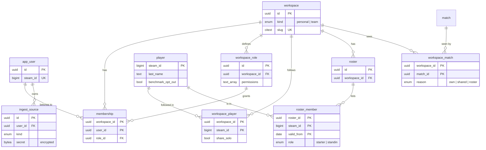
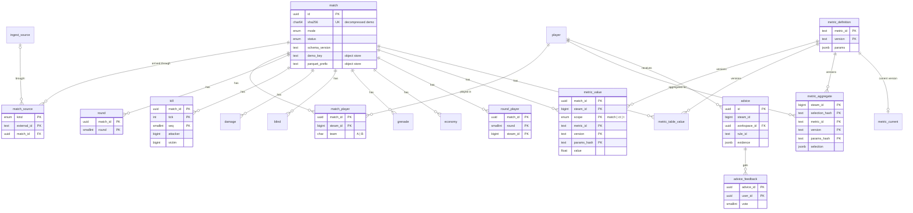

# Phase 2 database: entity-relationship diagram

The reference schema is [schema.sql](schema.sql), and the decisions behind it are in [ADR 0011](../adr/0011-phase-2-database-schema.md). Only keys and the columns that carry a relationship are shown here.

## Tenancy, players and access

## Matches, events and metrics

`damage`, `blind`, `grenade` and `economy` are keyed like `kill` (by `match_id` with a tick and a sequence, a grenade id, or a round and a player). The job queue (`job`) has no relationships.
