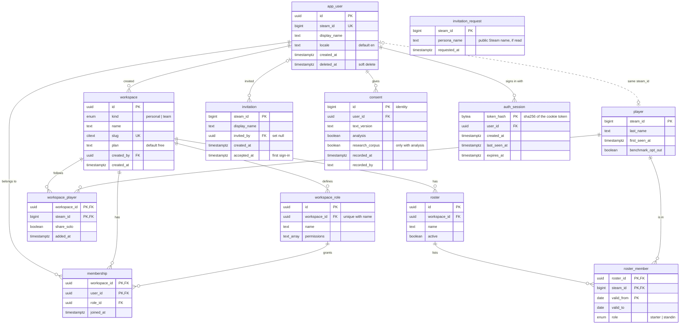
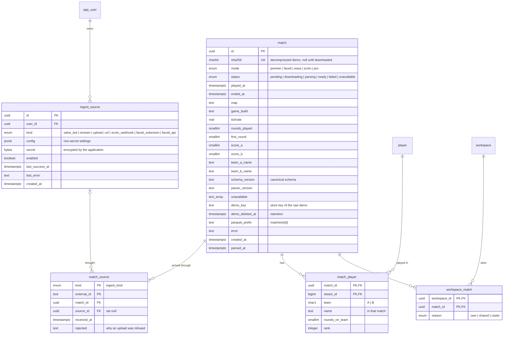
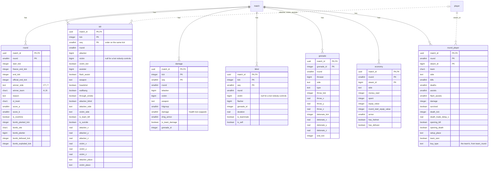
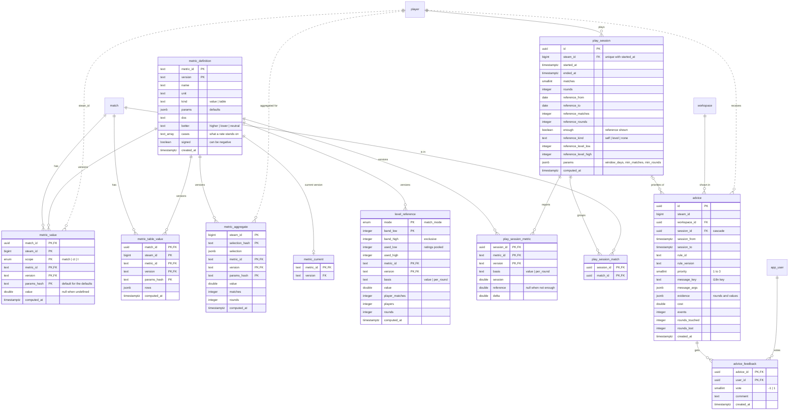
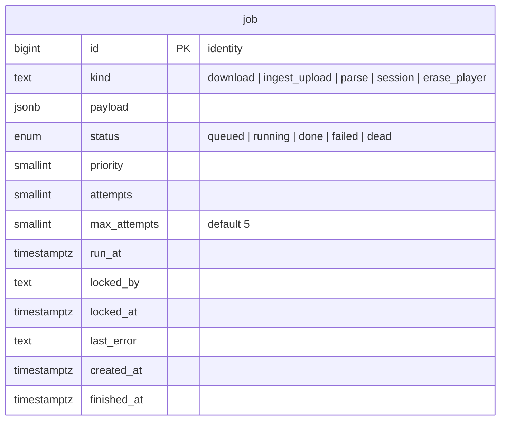

# Phase 2 database: entity-relationship diagram

The decisions behind the schema are in [ADR 0011](../adr/0011-phase-2-database-schema.md). The migrations in [`db/`](../../db/src/untraded_db/migrations/versions/) are the source of truth (ADR 0006); this page shows the schema **after the last one, 0013**. [schema.sql](schema.sql) is the reference schema of ADR 0011, kept identical to migration 0001, which a test checks (`db/tests/test_migrations.py`): it does not hold the later migrations.

Every table and column is shown. Solid lines are foreign keys; dotted lines are links by Steam id that have no foreign key constraint (event and metric rows keep the Steam ids of every player of a match). Types: `char1` is `char(1)`, `char64` is `char(64)`, `text_array` is `text[]`, `double` is `double precision`.

| Migration | Adds |
|---|---|
| 0001 initial | the reference schema of ADR 0011 (tenancy, ingestion, matches, canonical events, metrics, advice, job queue, row-level security) |
| 0002 sessions | `match.ended_at`, `auth_session`, play sessions and their report, the `untraded_api` role |
| 0003 metric direction | `metric_definition.better` |
| 0004 level reference | `level_reference`; `play_session.reference_kind`, `reference_level_low`, `reference_level_high` |
| 0005 session advice | `advice.session_id`, `cost`, `events`, `rounds_touched`, `rounds_lost`; the API may write `advice_feedback` |
| 0006 metric cases | `metric_definition.cases`, `signed` |
| 0007 consent | `consent`, the `consent_current` view |
| 0008 invitations | `invitation`; first sign-in of an invited account; the player's own source functions |
| 0009 erasure | `request_erasure`, `request_my_erasure` |
| 0010 uploads | `match_source.rejected`; the upload functions |
| 0011 invitation requests | `invitation_request`; `request_invitation(steam, persona)` for the API role |
| 0012 Untraded Rating | `metric_wide_current.untraded` |
| 0013 blinded bots | `blind.victim` nullable |

## Tenancy and players

- `consent` is never updated: a player's consent is their latest row, which the view `consent_current` (`user_id`, `text_version`, `analysis`, `research_corpus`, `recorded_at`) returns.
- An invited Steam account becomes a user, with a personal workspace (slug `u-{steam_id}`) and an `owner` role (`*`), at its first sign-in (`open_auth_session`).

## Ingestion and matches

`match_source.rejected` is a stable code: `not_a_demo`, `corrupt`, `too_large`, `unsupported_mode`, `not_a_player`.

## Canonical events and the round model

Copies of the Parquet tables useful in SQL ([canonical tables](../canonical-tables.md), schema 1.1, and `round_player` of the [round model](../round-model.md)). Shots, grenade paths, bomb events, inventory changes, player ticks and the other derived tables stay in Parquet only.

`damage`, `blind`, `grenade` and `economy` also name their players by Steam id, without a constraint, like `kill`.

## Metrics, sessions and advice

- `metric_wide_current` is a view of the current values (`metric_current`, default parameters), one row per match, player and scope: `kills`, `deaths`, `adr`, `kast`, `hltv1`, `untraded_deaths`, `untraded` (0012). It runs with the caller's rights (`security_invoker`).
- A **play session** groups a player's matches while there is at most one hour between the end of one and the start of the next. Its report compares it with the player's own 30 days before (`reference_kind` `self`), else with a level (`level`, from `level_reference`: anonymous aggregates of a rating band), else nothing (`none`).

## Job queue

`job` has no relationships. Inserting a queued job notifies the channel `job_{kind}` (trigger `job_queued`).

## Row-level security and the API role

The API runs each transaction as `untraded_api` (no `BYPASSRLS`) with `app.user_id` set to the signed-in user. The services' own role (worker, collector, migrations) bypasses row-level security.

| Rows visible to `untraded_api` | Tables |
|---|---|
| a match one of the user's workspaces sees (`visible_match`) | `match`, `match_player`, `round`, `kill`, `damage`, `blind`, `grenade`, `economy`, `round_player`, `metric_value`, `metric_table_value`, `workspace_match` |
| through such a match, or a player followed by one of the user's workspaces (`visible_player`) | `player` |
| the user's workspaces (`is_member`) | `workspace`, `membership`, `workspace_role`, `workspace_player`, `roster`, `roster_member`, `advice` |
| followed players (`followed_player`) | `metric_aggregate` |
| the user's own player, or a followed one | `play_session`, `play_session_match`, `play_session_metric` |
| the user's own rows | `ingest_source`, `advice_feedback`, `consent`; `app_user` (and the users they share a workspace with) |
| none (functions only) | `auth_session` |
| no row-level security | `metric_definition`, `metric_current`, `level_reference`, `invitation`, `invitation_request`, `job` |

- `untraded_api` reads every table and view of migrations 0001 and 0002 except `auth_session`, `ingest_source` and `job`, plus `level_reference`, `consent` and `consent_current`; it has no grant on `invitation`. It writes only `advice_feedback` (the user's own votes) and `consent` (insert), and otherwise goes through `SECURITY DEFINER` functions:
  - sign-in: `open_auth_session`, `auth_session_user`, `close_auth_session`;
  - the player's Steam codes: `my_source`, `set_my_source`, `pause_my_sources` (the API never reads a secret);
  - erasure: `request_my_erasure` (`request_erasure`, for any Steam id, is not granted to it); both mark the account deleted, pause its sources, close its sessions, drop a pending invitation and queue an `erase_player` job;
  - uploads: `my_upload_refusal`, `add_my_upload` (a pending `match`, its `match_source` and an `ingest_upload` job), `my_uploads`.
